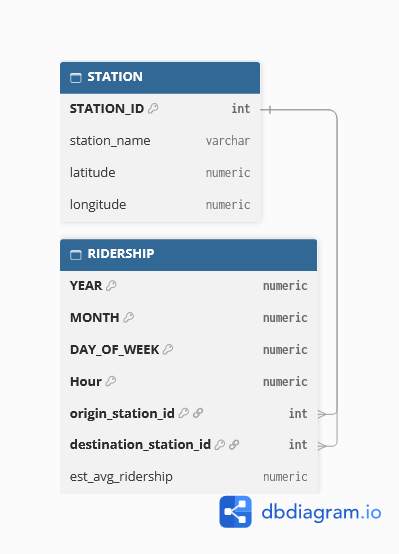

# MTA Subway Origin-Destination Ridership Estimates Data Pipeline

## Introduction
I chose this dataset because I have a deep love and appreciation for public transit. I think this is an interesting data set to get a feel for how people flow through NYC.

## Data Set Documentation

[MTA Subway Origin-Destination Ridership Estimates Data Pipeline](https://data.ny.gov/Transportation/MTA-Subway-Origin-Destination-Ridership-Estimate-B/28vm-gjqr/about_data)

## ER Diagram
The schema diagram was generated from [schema.dbml](schema.dbml) using [dbdiagram.io](https://dbdiagram.io).

## Setup